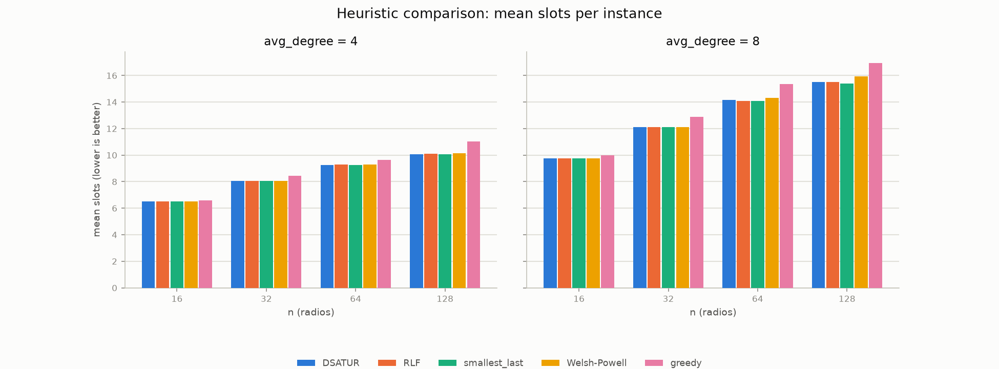
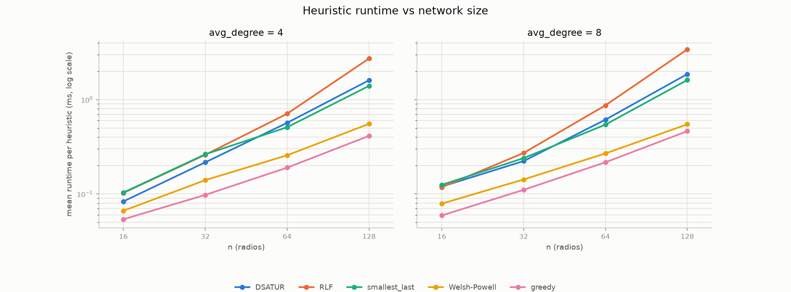

# TDMA Schedule Optimizer &amp; EMANE Emulation — Design Documentation

**Vaan Megam Networks — Wireless Developer Internship**
Author: balatharunr · Repository: TDMA · Last updated: 2026-09-27

## About this document

This is the single design document for **both parts** of the internship task:

- **[Part 1 — TDMA Schedule Optimizer](#part-1-tdma-schedule-optimizer)** (complete): a Python tool that computes a provably-optimal, independently-verified, benchmarked, conflict-free TDMA schedule from radio positions. Documented in full below: problem understanding, design process and the thought process behind every major decision, algorithms and complexity, the data contract, verification and testing strategy, final values, and benchmark results.
- **[Part 2 — EMANE Physical-Layer Emulation](#part-2-emane-physical-layer-emulation)** (not started yet): will run the Part 1 schedule against a real emulated radio physical/MAC layer (EMANE) and measure how well it is enforced. Its section below is a placeholder and will be filled in, in the same structure as Part 1, once that work begins.

---

# PART 1: TDMA Schedule Optimizer

## 1. Problem understanding

N radios (16 in the brief) sit at fixed 2D coordinates and share a single frequency channel. The task is to build a **TDMA schedule**: an assignment of one repeating time slot to every radio such that no two radios that could collide ever transmit in the same slot.

The subtlety is *which* radios "could collide." It is not enough for two radios that hear each other directly to avoid the same slot — that is the obvious case (a half-duplex radio cannot transmit and receive at once, so if A and B hear each other, they cannot share a slot either way). There is a second, easy-to-miss failure mode: the **hidden-terminal problem**. Two radios A and C can be too far apart to hear each other at all, yet both be within range of a third radio B. If A and C transmit in the same slot, B — which hears both — sees a collision, even though A and C never "saw" one another. So A and C must not share a slot either, despite having no direct link.

That means the real constraint is not "radios within range of each other" but **"radios within two hops of each other."** This project models the network as a graph and turns scheduling into a well-understood problem — graph colouring — which it then solves exactly, not just approximately, before handing the result to Part 2.

## 2. Design process & thought process

The subsections below are the actual decisions made, in the order they came up, including the alternatives that were considered and rejected and why.

### 2.1 Interference model: protocol (unit disk graph) vs. physical (SINR)

Two radios could be modelled as linked either by:
- **Protocol model (chosen):** a hard range cutoff — two radios are linked exactly when their Euclidean distance is at most the radio range. Simple, deterministic, and it is literally what the brief specifies ("500 m range"). This is the standard simplification used throughout wireless-networking literature (a *unit disk graph*), precisely because it turns scheduling into a graph problem with efficient, well-understood algorithms.
- **Physical model (SINR):** sum every transmitter's received signal strength at every radio and require a signal-to-interference-plus-noise ratio above some threshold. More realistic, but it needs a full physical layer, which the brief does not ask for in Part 1 — this is exactly where EMANE (Part 2) comes in: it checks the schedule this project produces against a much closer-to-reality precomputed-pathloss physical layer.

Decision: unit disk graph for Part 1 (matches the brief exactly, and is the right level of abstraction for "produce a schedule"); Part 2 tests that same schedule against something closer to physical reality.

### 2.2 Conflict model: distance-1 vs. distance-2

As in §1, distance-1-only conflict misses hidden terminals. This is not just an argument on paper — `tdma_brain/heuristics.py`'s `naive_distance1()` implements the distance-1-only colouring **on purpose**, specifically so it can be demonstrated to fail: `--algorithm naive-d1` runs it, and the independent verifier catches every hidden-terminal collision it produces. The full benchmark (§8) confirms this is not a corner case — naive-D1 was conflict-free in exactly **0% of 160** random test instances.

Decision: build the conflict graph as **H = G²** (every pair of radios at most 2 hops apart in the radio graph G), using `networkx.power(G, 2)`. A valid schedule is a **proper vertex colouring of H**: two radios joined by an edge in H must get different colours (slots).

### 2.3 Node (broadcast) scheduling vs. link scheduling

A slot in this project belongs to a **radio**, not to a link. Real wireless radios broadcast: one transmission is heard by every neighbour, not delivered to one paired receiver the way a wired link works. So the thing being scheduled is "who may transmit," not "who may talk to whom." This is also what makes the problem a graph-*vertex*-colouring problem (colour the nodes of H) rather than the harder problem of scheduling edges.

### 2.4 One heuristic, or a portfolio?

It would have been tempting to pick "the best" graph-colouring heuristic and stop there. That does not work: **no single heuristic always wins.** Concrete, measured example — the `grid16_400m` golden topology (16 nodes, 400 m grid spacing, 500 m range):

| Heuristic | Slots found |
|---|---:|
| DSATUR | 5 |
| RLF | 5 |
| smallest_last | 6 |
| largest_first (Welsh-Powell) | 6 |
| greedy (natural order) | 6 |

DSATUR and RLF reach the 5-slot optimum immediately; the other three need one slot more. On a different topology the ranking can flip (§8's benchmark shows this at scale). So the optimizer runs **all five** deterministic heuristics — DSATUR, RLF, smallest-last, largest-first/Welsh-Powell, and plain greedy first-fit — and keeps whichever finds the shortest frame, with the earlier heuristic in a fixed priority order winning ties so the result never depends on an incidental ordering.

### 2.5 Polishing before searching: iterated greedy

An exact, NP-hard search is expensive. Before reaching for it, the portfolio's winning colouring is passed through **iterated greedy** (Culberson & Luo, 1996): repeatedly re-run first-fit colouring, but keep each existing colour class together as a block and only reorder the blocks (largest-first, reversed, or shuffled — seeded, so reproducible). A theorem behind this technique guarantees a pass **never needs more slots** than its input — enforced defensively in code, not just assumed: `iterated_greedy_passes` raises `RuntimeError` if that theorem is ever violated, which would mean a bug. In practice it sometimes finds a strictly shorter frame for free, cheaply, before any exact search is attempted.

### 2.6 Two lower bounds — and why even both together are not always enough

A lower bound proves "no schedule can possibly use fewer than this many slots." If the frame length found equals the bound, that alone is a **proof** of optimality, no search required. Two bounds are computed:

- **max-degree + 1**: a radio and all of its 1-hop neighbours are pairwise within 2 hops of each other, so together they form a clique in H — that neighbourhood alone needs `degree + 1` distinct slots.
- **maximum clique of H** (exact, via `networkx.max_weight_clique`): the largest group of radios that *all* mutually conflict. Never smaller than max-degree + 1, because H's structure can hide bigger mutually-conflicting groups than any single radio's own neighbourhood.

The lower bound is `max(maxdeg+1, clique size)`. The important, verified finding is that **even this combined bound is not always tight.** The `ring16_r1150m` golden example proves it — this is the tool's own real output, not a hypothetical:

```
LOWER BOUND: maxdeg+1 = 3, max clique = 3 {Node_14, Node_15, Node_16} -> LB = 3
RESULT: 4 slots, lower bound 3 -> exact search: 3 slots impossible -> PROVEN OPTIMAL (exact search)
```

All five heuristics agree on 4 slots immediately and iterated greedy cannot improve on it, yet the lower bound says only 3. Without a further step, the honest answer would have to be "found 4, cannot prove it's optimal — 3 might still be possible." Closing that gap is exactly what the next decision is for.

### 2.7 Closing the gap: an exact search, not a guess

When the polished heuristic result is still above the lower bound, a **time-limited exact search** tries to prove whether the gap can be closed:

- It only ever asks "can this graph be coloured with *k* slots?" for `k` strictly between the lower bound and the current best — never searches below the proven-impossible lower bound, never repeats work the heuristics already did.
- It is a **DSATUR-ordered branch-and-bound**: at each step, colour the most-constrained uncoloured radio (the same rule as the DSATUR heuristic: highest saturation, then most uncoloured neighbours, then natural order) with the smallest slot no neighbour uses, and backtrack when stuck.
- **Symmetry breaking**: a brand-new, never-yet-used slot may only ever be opened as slot number `used_so_far` — never any higher unused number. Any two colourings that differ only by renaming never-used slots are the same colouring in disguise, so this alone eliminates almost all of the `k!` redundant permutations a naive search would otherwise explore.
- It is **time-limited and honest about it**: if the deadline passes before the search finishes, the result is reported as `BEST_FOUND` — the best colouring found, with the open gap to the lower bound stated plainly — rather than silently claiming optimality it has not earned. On `ring16_r1150m` the search finishes fast enough to *prove* 3 slots is impossible, upgrading the result to `PROVEN_OPTIMAL_BY_SEARCH`.

This was deliberately chosen over pulling in an external ILP/SAT solver dependency: the space that actually needs exploring is small (the search starts from a near-optimal heuristic result and typically only has to close a gap of one or two slots, on conflict graphs of at most a few hundred nodes), so a targeted, symmetry-broken backtracking search is both fast enough in practice (proven optimal in well under a second even at n = 128, §8) and keeps the project dependency-light and fully auditable — every line of the search is code in this repository, not a black box.

### 2.8 Independent verification: don't trust your own conflict graph to check itself

A subtle risk: if the code that *builds* the conflict graph H has a bug, a verifier that also relies on H could share that exact bug and never catch it. So the verifier (`tdma_brain/verify.py`) is written to be **structurally independent**: it re-derives "who could collide with whom" directly from the radio graph G, by breadth-first search out to 2 hops from every radio, and never imports or touches H at all. It also separately checks that the schedule's own internal tables agree with each other (the per-node slot map, the per-slot member lists, and the Boolean matrix must all say the same thing). This is what makes a "PROVEN OPTIMAL" claim trustworthy rather than circular: two independently-written pieces of code — the colourer's H, and the verifier's BFS — have to agree.

### 2.9 Determinism

Every algorithm in this project breaks ties by **natural node order** (`Node_2` before `Node_10`, not lexicographic order, which would put `Node_10` first) rather than relying on set/dict iteration order or Python's hash randomization. The only randomness anywhere is a seeded `random.Random(seed)` inside iterated greedy, defaulting to `seed=42`. The same input therefore always produces the exact same schedule on any machine — necessary for a reproducible deliverable a grader can re-run and compare byte-for-byte.

### 2.10 Input validation and CLI design

The CLI (`tdma_schedule.py` → `tdma_brain/cli.py`) accepts coordinates either inline as a JSON string or via `--file`, and rejects malformed input with specific, actionable messages instead of a stack trace: duplicate node names, non-numeric or non-finite coordinates, JSON booleans disguised as numbers (`true`/`false` are technically a subtype of Python `int` and have to be rejected explicitly), wrong-shaped points, and empty input are all caught in `tdma_brain/io_utils.py` before they can reach the graph or scheduling code. Exit codes follow Unix convention (`0` success, `1` a verification failure, `2` a usage/input error) so the tool composes cleanly in scripts.

## 3. System architecture

```
                    ┌──────────────┐
 JSON coordinates → │  io_utils.py │  parse & validate {name: (x, y)}
                    └──────┬───────┘
                           ▼
                    ┌──────────────┐
                    │ topology.py  │  build radio graph G (unit disk graph)
                    └──────┬───────┘
                           ▼
                    ┌──────────────┐
                    │ topology.py  │  build conflict graph H = G²  (nx.power)
                    └──────┬───────┘
                           ▼
                    ┌───────────────────────────────────────────────┐
                    │ optimizer.py                                   │
                    │  1. run all 5 heuristics (heuristics.py)       │
                    │  2. keep the shortest frame                    │
                    │  3. polish with iterated greedy                │
                    │  4. compute the lower bound (bounds.py)        │
                    │  5. if a gap remains: exact search (exact.py), │
                    │     time-limited                                │
                    └──────┬──────────────────────────────────────────┘
                           ▼
                    ┌──────────────┐
                    │ schedule.py  │  canonical Schedule (slots renumbered by first appearance)
                    └──────┬───────┘
                           ▼
              ┌────────────┼─────────────┬──────────────────┐
              ▼                          ▼                  ▼
      ┌──────────────┐           ┌──────────────┐   ┌──────────────┐
      │  verify.py   │           │  report.py   │   │   viz.py     │
      │ (independent │           │ ASCII report │   │  topology &  │
      │  BFS check)  │           │  --verbose   │   │ timeline PNG │
      └──────────────┘           └──────────────┘   └──────────────┘
                                                      ┌──────────────┐
                                                      │ schedule.py  │
                                                      │ JSON / CSV   │
                                                      └──────────────┘
```

Walking one real example end to end — the official `grid16_300m` input, 16 radios in a 4×4 grid, 300 m spacing, 500 m range:

1. **Parse & validate** the 16 `{name: [x, y]}` pairs.
2. **Build G**: 42 links (pairs within 500 m of each other).
3. **Build H = G²**: 90 conflict pairs, of which 48 are hidden-terminal pairs (2 hops, no direct link) and 42 are direct 1-hop pairs.
4. **Run the portfolio**: DSATUR finds 9 slots (the winner here — §8 shows how often each heuristic wins across many topologies).
5. **Iterated greedy** (300 passes, seed 42): no improvement — already at 9.
6. **Lower bound**: max-degree + 1 = 9; the exact maximum clique of H is also 9 (`{Node_06, Node_07, Node_08, Node_10, Node_11, Node_12, Node_14, Node_15, Node_16}`, 9 radios that all mutually conflict) → LB = 9.
7. **9 = 9**: the frame already matches the lower bound, so no exact search is needed — status `PROVEN_OPTIMAL_BY_BOUND`.
8. **Independent verification**: BFS from every radio out to 2 hops confirms zero collisions.
9. **Report**: printed to stdout (§7); optionally exported as `schedule.json`, CSV, and plotted.

## 4. Algorithms & complexity

| Component | Algorithm | Approach | Complexity (n = radios, k = slots used) |
|---|---|---|---|
| Radio graph | Unit disk graph | All-pairs Euclidean distance ≤ range | O(n²) |
| Conflict graph | G² | `networkx.power(G, 2)` (BFS-based) | ≈ O(n²) at these sizes/densities |
| DSATUR | Brélaz 1979 | Colour the most-constrained (saturation, then uncoloured degree) node first | O(n²) |
| RLF | Leighton 1979 | Build one slot at a time, packing it as full as possible | O(n²) |
| smallest-last | Matula–Beck 1983 | Peel the least-connected node repeatedly, colour in reverse | O(n²) |
| largest-first | Welsh–Powell 1967 | First-fit, most-conflicted node first | O(n log n + n·k) |
| greedy | — | First-fit in natural node order | O(n·k) |
| iterated greedy | Culberson & Luo 1996 | 300 reordered first-fit passes | O(iterations · n · k) |
| lower bound (maxdeg+1) | — | Max degree of G, plus one | O(n) |
| lower bound (clique) | exact max clique | `networkx.max_weight_clique` on H (skipped above 300 nodes) | NP-hard worst case; fast in practice at these sizes |
| exact search | DSATUR-ordered branch & bound, symmetry-broken | Backtracking, `k` from best−1 down to LB | NP-hard worst case (graph colouring); in practice closes small gaps in well under a second up to n = 128 (§8) |
| verification | BFS, cutoff 2 | From every radio, independent of H | O(n · local 2-hop neighbourhood size) |

Graph colouring (deciding the chromatic number) is NP-hard in general — exactly why the design layers cheap heuristics (fast, no guarantees) → a cheap improving pass (iterated greedy) → cheap bounds (nearly free, and often enough by themselves to prove optimality) → an expensive exact search **only for the remaining gap, only when one exists, and only up to a time budget**. This ordering keeps the tool fast on every instance while staying honest about the rare instance where it cannot (yet) prove optimality within the time given.

## 5. The data contract: `schedule.json`

`tdma_brain/schedule.py` defines and **freezes** (as of Division 4 of the build) the JSON schema `tdma-schedule/v1` that Part 2 will consume, so nothing about it changes once Part 2 starts reading it:

```json
{
  "schema": "tdma-schedule/v1",
  "generator": "tdma_brain <version>",
  "radio_range_m": 500.0,
  "nodes": ["Node_01", "Node_02", "..."],
  "coordinates": {"Node_01": [0.0, 0.0], "...": ["...", "..."]},
  "links": [["Node_01", "Node_02"], "..."],
  "frame_length": 9,
  "node_to_slot": {"Node_01": 0, "...": "..."},
  "slot_to_nodes": [["Node_01", "Node_04", "..."], "..."],
  "extra_tx_slots": {},
  "matrix": [[1, 0, 0, "..."], "..."],
  "lower_bound": 9,
  "optimality": "PROVEN_OPTIMAL_BY_BOUND",
  "algorithm": "DSATUR",
  "verified": true
}
```

`extra_tx_slots` exists for a possible future multi-slot-per-radio extension (e.g. a max-reuse mode); it is present but empty in every schedule produced so far. The Boolean matrix is also exportable as CSV (`--export-csv`), RFC 4180-quoted so node names containing commas still round-trip correctly through spreadsheet software.

## 6. Verification & testing strategy

Three independent layers of confidence, deliberately kept separate so a bug in one layer cannot hide behind another:

1. **Golden values, computed before any scheduling code was written.** `tests/golden.py` records 9 hand-picked topologies (a grid, a ring, isolated nodes, a dense cluster, a minimal 3-node hidden-terminal example, etc.) together with their node/link/conflict-pair counts, `maxdeg+1`, the exact max-clique size, and the exact chromatic number — all computed independently and exactly. If the running code ever disagrees with a number here, the code is wrong, never the golden value.
2. **Independent runtime verification** (§2.8): every schedule the optimizer produces is checked by a BFS-based verifier that shares no code with the graph-colouring path.
3. **657 automated tests** (`pytest -q`, all passing):

   | File | Tests | Covers |
   |---|---:|---|
   | test_topology.py | 70 | radio graph / conflict graph construction, hidden-terminal detection |
   | test_heuristics.py | 70 | all 5 heuristics + iterated greedy + naive-d1, determinism |
   | test_schedule.py | 49 | canonicalisation, schedule.json round-trip, CSV export |
   | test_verify.py | 23 | the independent verifier, including deliberately-broken schedules |
   | test_bounds.py | 28 | maxdeg+1 and max-clique lower bounds |
   | test_exact.py | 40 | the branch-and-bound search, symmetry breaking, timeouts |
   | test_optimizer.py | 24 | the full pipeline: portfolio → polish → bound → search |
   | test_report.py | 78 | the ASCII report and `--verbose` output |
   | test_io.py | 60 | input parsing and validation, every rejection path |
   | test_cli.py | 106 | the CLI end to end, every flag, real subprocess runs |
   | test_viz.py | 40 | both plots, every proof status, every golden example |
   | test_benchmark.py | 25 | the benchmark harness, a real subprocess run |
   | test_scheduling_golden.py | 44 | every golden example scheduled and verified at the proven optimum |
   | **Total** | **657** | **0 failed** |

   Every commit in this repository has also been checked out into a clean, throwaway `git worktree` and had the full suite re-run there, to prove no commit's passing tests secretly depend on an uncommitted file.
4. **Mutation testing** (Divisions 1–3, self-imposed QA, not part of the committed repository): a scratch script planted deliberate one-line bugs (off-by-one slot numbers, flipped comparisons, wrong tie-breaks, etc.) into a temporary copy of the codebase, one at a time, and confirmed the test suite failed for every one of them — 14/14 (Division 1), 37/37 (Division 2), 46/46 (Division 3, after one gap the process itself found was closed with a new test). This checks that the tests actually detect bugs, not merely that they pass.

## 7. Final values: the official input

The brief's 16-node, 300 m-spacing grid, 500 m radio range (`examples/grid16_300m.json`):

```
================================================================
               TDMA TOPOLOGY OPTIMIZATION REPORT
================================================================
Total Nodes Processed   : 16
Configured Radio Range  : 500.0 meters
Optimized Frame Length  : 9 unique timeslots (Lower is better)
Scheduling Algorithm    : DSATUR on 2-hop conflict graph (G^2)
Spatial Reuse Factor    : 1.78 nodes/slot (plain TDMA = 1.00)
Lower Bound (proof)     : 9 timeslots (max 2-hop clique = 9, maxdeg+1 = 9)
Optimality              : PROVEN OPTIMAL (frame length = lower bound)
-----------------------------------------------------------------
 NODE -> SLOT ASSIGNMENTS:
  Node_01: Slot 0
  Node_02: Slot 1
  Node_03: Slot 2
  Node_04: Slot 0
  Node_05: Slot 3
  Node_06: Slot 4
  Node_07: Slot 5
  Node_08: Slot 3
  Node_09: Slot 6
  Node_10: Slot 7
  Node_11: Slot 8
  Node_12: Slot 6
  Node_13: Slot 0
  Node_14: Slot 1
  Node_15: Slot 2
  Node_16: Slot 0

 STRUCTURAL TDMA SCHEDULE MATRIX (Slot x Node Boolean Matrix):
Slot \ Node | 01 | 02 | 03 | 04 | 05 | 06 | 07 | 08 | 09 | 10 | 11 | 12 | 13 | 14 | 15 | 16
-------------------------------------------------------------------------------------------
 Slot 00    | 1  | 0  | 0  | 1  | 0  | 0  | 0  | 0  | 0  | 0  | 0  | 0  | 1  | 0  | 0  | 1
 Slot 01    | 0  | 1  | 0  | 0  | 0  | 0  | 0  | 0  | 0  | 0  | 0  | 0  | 0  | 1  | 0  | 0
 Slot 02    | 0  | 0  | 1  | 0  | 0  | 0  | 0  | 0  | 0  | 0  | 0  | 0  | 0  | 0  | 1  | 0
 Slot 03    | 0  | 0  | 0  | 0  | 1  | 0  | 0  | 1  | 0  | 0  | 0  | 0  | 0  | 0  | 0  | 0
 Slot 04    | 0  | 0  | 0  | 0  | 0  | 1  | 0  | 0  | 0  | 0  | 0  | 0  | 0  | 0  | 0  | 0
 Slot 05    | 0  | 0  | 0  | 0  | 0  | 0  | 1  | 0  | 0  | 0  | 0  | 0  | 0  | 0  | 0  | 0
 Slot 06    | 0  | 0  | 0  | 0  | 0  | 0  | 0  | 0  | 1  | 0  | 0  | 1  | 0  | 0  | 0  | 0
 Slot 07    | 0  | 0  | 0  | 0  | 0  | 0  | 0  | 0  | 0  | 1  | 0  | 0  | 0  | 0  | 0  | 0
 Slot 08    | 0  | 0  | 0  | 0  | 0  | 0  | 0  | 0  | 0  | 0  | 1  | 0  | 0  | 0  | 0  | 0
-------------------------------------------------------------------------------------------
Execution finalized cleanly. Schedule verified conflict-free.
================================================================
```

The same output is produced whether the coordinates are passed as the brief's JSON string argument or with `--file examples/grid16_300m.json` (checked byte for byte), and the saved records `results/grid16_300m.schedule.json` and `results/grid16_300m.matrix.csv` are byte-identical to a fresh `--export-json` / `--export-csv` run.

**Frame length 9, instead of plain TDMA's 16 — a 43.75% reduction** (`1 − 9/16`) **— at a 1.78× spatial reuse factor.** This is not merely "the best schedule found": it is **proven optimal**. The 9 radios `{Node_06, Node_07, Node_08, Node_10, Node_11, Node_12, Node_14, Node_15, Node_16}` all mutually conflict (a clique of H), so no valid schedule for this topology can possibly use fewer than 9 slots — and this schedule reaches that floor exactly. Spatial reuse is real and safe: the 10 pairs of radios that share a slot (for example `Node_01`, `Node_04`, `Node_13` and `Node_16`, the four corners, all in Slot 0) are each exactly 3 hops apart — more than 2, as the brief requires.

**About the brief's sample output.** The brief illustrates the report format with a 5-slot schedule. Fed to this project's verifier on the same 300 m grid, that sample has **21 hidden-terminal collisions** (for example `Node_01` and `Node_03` share Slot 0, yet both reach `Node_02` and `Node_06`), and the grid's lower bound is 9, so no 5-slot schedule can exist for it. The sample is a format illustration, not an achievable target; the 9-slot result above is the true optimum.

### All 9 golden examples

| Topology | Nodes | Links (1-hop) | Conflict pairs (≤2-hop) | maxdeg+1 | max clique | **Optimal slots** | Notes |
|---|---:|---:|---:|---:|---:|---:|---|
| grid16_300m (**official input**) | 16 | 42 | 90 | 9 | 9 | **9** | bound is tight |
| grid16_400m | 16 | 24 | 58 | 5 | 5 | **5** | DSATUR/RLF find it immediately; 3 of 5 heuristics don't (§2.4) |
| grid16_250m | 16 | 58 | 110 | 11 | 12 | **12** | densest grid; clique bound beats maxdeg+1 |
| line16_400m | 16 | 15 | 29 | 3 | 3 | **3** | a chain |
| cluster16_30m | 16 | 120 | 120 | 16 | 16 | **16** | one dense clump — every radio needs its own slot |
| isolated16_1000m | 16 | 0 | 0 | 1 | 1 | **1** | no radio hears any other |
| ring16_r1150m | 16 | 16 | 32 | 3 | 3 | **4** | **both bounds under-predict** — only the exact search proves it (§2.6) |
| two_clusters16 | 16 | 56 | 56 | 8 | 8 | **8** | two disconnected dense clusters |
| hidden_terminal3 | 3 | 2 | 3 | 3 | 3 | **3** | minimal hidden-terminal example: A–B–C in a line; A and C never hear each other, yet both must avoid B's slot |

All nine are proven optimal; the ring case is flagged because it is the one topology in the set where the cheap bounds alone are not enough — exactly why the exact search is a load-bearing part of the design, not an unused fallback.

## 8. Benchmark results (full run)

Generated by `python bench/benchmark.py` (the full, non-`--quick` grid): **160 instances** — `n` ∈ {16, 32, 64, 128} radios × `avg_degree` ∈ {4, 8} × 20 random seeds each, random geometric topologies (`bench/benchmark.py`'s `random_topology()`, the same square-area formula the guide specifies), 2-second exact-search time budget per instance. Full data: `results/benchmark.csv`; full generated summary: `results/benchmark_summary.md`.

**Headline result: 160/160 instances proven optimal, zero verification failures, 14 seconds total wall time.**

### Heuristic quality (mean slots — lower is better) and lower-bound hit rate

| n | avg_degree | DSATUR | RLF | smallest_last | largest_first | greedy | **final** | LB hit % | proven optimal % |
|---|---|---:|---:|---:|---:|---:|---:|---:|---:|
| 16 | 4 | 6.50 | 6.50 | 6.50 | 6.50 | 6.60 | **6.50** | 100% | 100% |
| 16 | 8 | 9.75 | 9.75 | 9.75 | 9.75 | 10.00 | **9.75** | 100% | 100% |
| 32 | 4 | 8.05 | 8.05 | 8.05 | 8.05 | 8.45 | **8.05** | 100% | 100% |
| 32 | 8 | 12.10 | 12.10 | 12.10 | 12.10 | 12.90 | **12.10** | 100% | 100% |
| 64 | 4 | 9.25 | 9.30 | 9.25 | 9.30 | 9.65 | **9.25** | 100% | 100% |
| 64 | 8 | 14.15 | 14.10 | 14.10 | 14.30 | 15.35 | **14.10** | 100% | 100% |
| 128 | 4 | 10.05 | 10.10 | 10.05 | 10.15 | 11.05 | **10.05** | 100% | 100% |
| 128 | 8 | 15.50 | 15.50 | 15.40 | 15.95 | 16.95 | **15.40** | 100% | 100% |

`greedy` (plain first-fit, no smart ordering) is consistently the weakest single heuristic, and the gap widens as `n` grows — the measured motivation for running a portfolio instead of picking one heuristic up front (§2.4). DSATUR, RLF and smallest-last stay close to each other and close to (usually at) the lower bound.

### Reuse, runtime and the naive-D1 comparison

| n | avg_degree | mean reuse (n/K) | mean frame reduction | mean runtime (ms) | naive-D1 mean slots | naive-D1 conflict-free % |
|---|---|---:|---:|---:|---:|---:|
| 16 | 4 | 2.51× | 59.4% | 18.8 | 4.55 | **0%** |
| 16 | 8 | 1.67× | 39.1% | 21.9 | 5.95 | **0%** |
| 32 | 4 | 4.07× | 74.8% | 37.9 | 5.30 | **0%** |
| 32 | 8 | 2.72× | 62.2% | 44.4 | 7.35 | **0%** |
| 64 | 4 | 6.99× | 85.5% | 78.1 | 6.05 | **0%** |
| 64 | 8 | 4.59× | 78.0% | 89.2 | 8.40 | **0%** |
| 128 | 4 | 12.96× | 92.1% | 152.9 | 6.35 | **0%** |
| 128 | 8 | 8.38× | 88.0% | 198.5 | 9.25 | **0%** |

- **Spatial reuse grows with n at fixed density** — 2.5× at n=16 up to ~13× at n=128 (avg_degree=4) — because a bigger area at the same local density lets far-apart radios reuse the same slot safely, exactly as spatial-TDMA theory predicts.
- **naive-D1 is conflict-free in 0% of all 160 instances.** It always uses fewer slots (it is solving an easier, wrong problem), but it is unsafe on every single instance tested — hard, reproducible evidence that distance-2 colouring is not optional.
- **Runtime scales gracefully**: milliseconds at n=16, ~200 ms mean at n=128, well inside the 2-second time budget per instance — and that budget covers *all five* heuristics plus iterated greedy plus, when needed, the exact search, not just the winning heuristic.

### Plots





## 9. Limitations & future work (Part 1)

- **Single shared channel, single radio range for every node.** The model does not (yet) support heterogeneous radios with different ranges or multiple channels/frequencies.
- **Static topology.** The schedule is computed once for a fixed set of coordinates; there is no mobility or re-scheduling on topology change (out of scope for the brief, but a natural extension).
- **Exact search has a time budget.** For a very large or adversarially dense instance the search could time out before proving optimality — reported honestly as `BEST_FOUND` with the open gap stated, never silently. Not observed in any of the 160 benchmarked instances or the 9 golden examples at the sizes tested (n ≤ 128).
- **Optional `--max-reuse` mode** (letting well-separated radios each get more than one slot per frame, via `extra_tx_slots`) was scoped as optional in the build plan and was not implemented, in favour of finishing the mandatory deliverable and this documentation within the time available.
- **Physical-layer realism.** Part 1 deliberately uses the simple protocol/unit-disk model (§2.1); Part 2, below, is where the schedule is tested against a more realistic physical layer.

## References (Part 1)

- Brélaz, D. (1979). *New methods to color the vertices of a graph.* — DSATUR.
- Leighton, F. T. (1979). *A graph coloring algorithm for large scheduling problems.* — RLF.
- Matula, D. W. & Beck, L. L. (1983). *Smallest-last ordering and clustering and graph coloring algorithms.*
- Welsh, D. J. A. & Powell, M. B. (1967). *An upper bound for the chromatic number of a graph and its application to timetabling problems.*
- Culberson, J. C. & Luo, F. (1996). *Exploring the k-colorable landscape with iterated greedy.*
- NetworkX documentation: `networkx.power`, `networkx.max_weight_clique`.
- Vaan Megam Networks — *Wireless Developer Internship* brief (task specification; kept local, not part of this repository).

---

# PART 2: EMANE Physical-Layer Emulation

*Not started yet.* This section will be written once Part 2 begins, in the same structure as Part 1 above — problem understanding, design process, architecture, verification/enforcement evidence, final results, limitations, and references — covering how the Part 1 schedule (`schedule.json`, §5) is fed into a real EMANE TDMA MAC/PHY emulation, and what the enforcement experiments show (e.g. packet loss with vs. without the schedule enforced, across a 16-radio scenario in network namespaces with precomputed pathloss matching this project's 500 m radio-range model).
